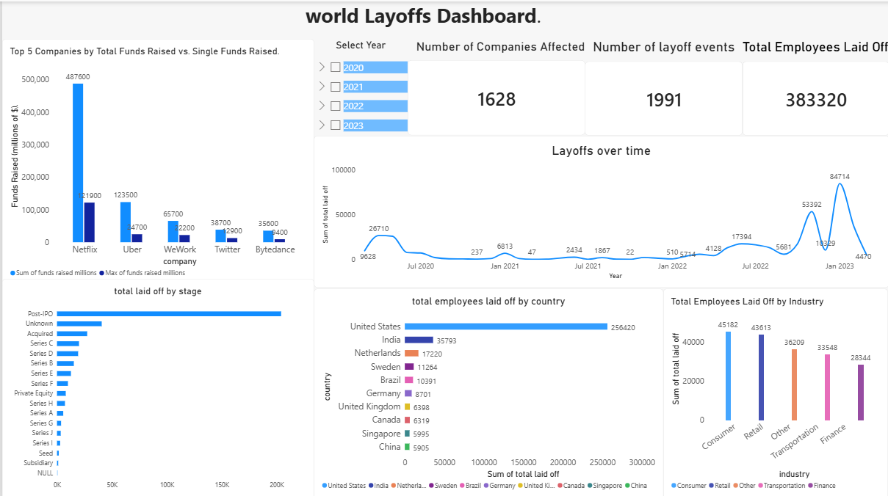

# world-layoffs-powerbi-dashboard.
Interactive Power BI dashboard analyzing global company layoffs (2020-2023) by industry, country, company stage and time.

## What this dashboard shows
- Total employees laid off, number of layoff events, and number of companies affected
- Layoffs over time, with a year slicer to filter everything
- Layoffs by industry, country and company stage
- Top 5 companies by total funds raised vs. single funds raised

## Tools
Power BI, data cleaning and visualization
